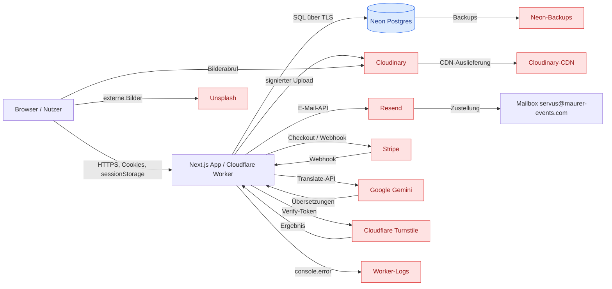

# Verzeichnis der Verarbeitungstätigkeiten (DSGVO Art. 30)

Stand: 14. November 2026. Erstellt aus Code (`src/`), DB-Schema (`src/db/schema.ts`) und Upload-Flows.
Quellen: `src/db/schema.ts`, `src/lib/privacy-notice.ts`, `docs/privacy-review.md`, `docs/retention-matrix.md`, `src/lib/retention.ts`, `src/lib/retention-policy.ts`, `src/app/actions/*`, `src/app/api/*`, `src/lib/*`.

## Hinweise zur Lesart

- **Speicherort** nennt die konkrete Neon-Tabelle/Spalte, den Cloudinary-Folder, den Mail-Postfach-Empfänger, Logs oder Backups.
- **Redis:** Im Code wird **kein Redis** verwendet. Rate-Limits liegen in der Neon-Tabelle `security_rate_limits`.
- **Vercel Blob:** In `next.config.mjs`/CSP noch als Altlast erlaubt (`*.public.blob.vercel-storage.com`), aber der aktive Upload-Dienst ist Cloudinary. `deleteCloudinaryImage()` warnt noch vor verwaisten Vercel-Blob-URLs.
- **Backups:** Providerseitige Backups (Neon/Cloudinary/Stripe/Resend) sind im Code nicht steuerbar; Löschungen können verzögert wirken.
- **Art. 9:** Nur Gesundheitsdaten (`staff_documents.kind = 'health_certificate'`) sind eine besondere Kategorie. Kamerabilder werden nicht hochgeladen (QR-Erkennung lokal).
- **Drittland:** Als "Ja" markiert, wenn Daten die EU verlassen können oder Drittlandzugriff (Support/Subprozessoren) möglich ist.

## Datenfluss (Mermaid)

Legende: Rot = Drittlandzugriff/EU-Verlassen möglich. Blau = primärer Datenspeicher.

## Verzeichnis (Tabelle)

| # | Verarbeitungstätigkeit | Zweck | Datenkategorien (Art. 9 markiert) | Betroffenengruppe | Quelle | Speicherort | Empfänger | IST-Löschfrist | Rechtsgrundlage (dokumentiert) | Drittland/EU |
|---|---|---|---|---|---|---|---|---|---|---|
| 1 | Website-Hosting & Zugriffsprotokolle | Bereitstellung, Fehleranalyse, Missbrauchsabwehr | IP-Adresse, Zeitpunkt, URL, HTTP-Methode/Status, Browser-/Geräteinfo, Referrer | Websitebesucher | Browser-Request | Cloudflare Worker Logs/Edge (global); laut Datenschutzerklärung Vercel-Logs; keine DB-Tabelle | Cloudflare; laut Datenschutzerklärung Vercel; Betreiber | Anbieter-/Sicherheitszyklus, nicht im Code definiert | Art. 6 Abs. 1 lit. f DSGVO | Ja |
| 2 | Cookies & Browser-Speicher | Sprache, Login, Wiederholung begonnener Buchung | `NEXT_LOCALE`; `admin_token` (Session-ID); `staff_token` (Session-ID); `reservation-checkout-attempt` (Wiederholungs-ID, Name, E-Mail, Event, Tag, Uhrzeit, Gästezahl, Paket, Tisch) | Besucher, Admins, Staff, Buchende | Browser | Browser-Cookie/Session Storage; Neon `admin_sessions`, `staff_sessions` (id, email, validUntil) | Betreiber; Hosting-Provider im Transit | Session-Cookie ohne festes Ablauf; Login-Cookies max. 7 Tage; sessionStorage Tab-Sitzung | § 25 Abs. 2 Nr. 2 TDDDG; Art. 6 Abs. 1 lit. b/f DSGVO | Transit Ja |
| 3 | Spam-/Missbrauchsschutz (Turnstile + Rate-Limits) | Bot-Schutz, Missbrauchsabwehr | IP, Browser-/Geräteinfo, Turnstile-Token; SHA-256 aus E-Mail+Vorgang, Zähler, Ablauf (`security_rate_limits.key/count/resetAt`) | Formularnutzer | Browser + Server | Cloudflare Turnstile (US); Neon `security_rate_limits` | Cloudflare; Betreiber | Rate-Limit-Fenster 15 Min; abgelaufene Einträge beim Cron gelöscht | Art. 6 Abs. 1 lit. f DSGVO; § 25 Abs. 2 Nr. 2 TDDDG | Ja |
| 4 | Kontaktformular | Bearbeitung von Anfragen, Angebote, Rückfragen | Name/Firma, E-Mail, Veranstaltungsart, Nachricht (max. 2000 Zeichen) | Anfragende | Kontaktformular | Kein DB-Speicher; E-Mail im Postfach `servus@maurer-events.com` via Resend; Rate-Limit-Hash | Betreiber (Postfach); Resend | Keine automatische Löschung; Postfach-/Provider-Retention nicht dokumentiert | Art. 6 Abs. 1 lit. b/f DSGVO | Ja (Resend) |
| 5 | Bewerbungen (Karriere) | Bewerbungsprüfung, Einstellungsentscheidung | Name, E-Mail, Telefon, Stelle, Nachricht, Anhang (Lebenslauf bis 2 MB: PDF/JPG/PNG/DOC/DOCX) | Bewerber | Karriereformular | Kein DB-Speicher; E-Mail + Anhang im Postfach via Resend; Rate-Limit-Hash | Betreiber (Postfach/HR); Resend | Keine automatische Löschung; Postfach-Retention | § 26 Abs. 1 BDSG; Art. 6 Abs. 1 lit. b DSGVO | Ja (Resend) |
| 6 | Online-Reservierung & Checkout | Buchungsvertrag, Kapazitätsplanung, Zahlungsabgleich, Ticket, Einlass | Gastname, E-Mail, Telefon (opt.), Gästezahl, Event, Datum, Uhrzeit, Paket, Tisch, Gesamtpreis, Status, Stripe-Session-ID, Idempotency-Key, Request-Hash, `checkoutParams`, QR-Code-Text, `pdfUrl`, `ticketEmailPayload` (vollständige E-Mail inkl. PDF-Base64), `privacyVersion`/`privacyAcceptedAt`, `confirmedAt/By`, `slipPrintedAt`, `paymentStatus`, `expiresAt`, `scannedAt`, Timestamps; abgeleitet `customers` | Buchende/Gäste | Checkout-Formular + Stripe | Neon `reservations` (alle Spalten), `customers`, `events`/`event_settings`, Stripe, Browser-SessionStorage | Betreiber; Stripe (Zahlung); Resend (Ticket); Helfer sehen bei Scan nur Name/Gästezahl/Tisch | Keine automatische Löschung von Buchungszeilen; abgelaufene pending werden als `expired` markiert (Cron), bleiben aber; bei ungültigem Status QR/`pdfUrl` null; `ticketEmailPayload` bleibt | Art. 6 Abs. 1 lit. b/c/f DSGVO | Ja (Stripe, Neon, Resend) |
| 7 | Manuelle Reservierung (Admin) | Erfassung von Buchungen im Auftrag von Gästen | Name, E-Mail, Gästezahl, Event, Datum, Idempotency-Key; sonst wie #6 (source='manual') | Gäste (durch Admin erfasst) | Admin-Eingabe | Neon `reservations` (source='manual') | Betreiber; Resend (Ticket) | Wie #6 | Art. 6 Abs. 1 lit. b/c DSGVO | Ja (Neon, Resend) |
| 8 | E-Mail-Reservierungsanfragen (Modus `email`) | Anfrage, Bestätigung/Ablehnung | Name, E-Mail, Telefon, Club/Firma, Gästezahl, Tische, Uhrzeit, Nachricht; Admin- und Gast-E-Mails | Anfragende | Reservierungsformular | Neon `reservations` (source='email', notes etc.); E-Mails im Postfach | Betreiber (`reservation_email`/`CONTACT_EMAIL`); Gast; Resend | Keine automatische Löschung | Art. 6 Abs. 1 lit. b DSGVO | Ja (Resend) |
| 9 | Warteliste | Benachrichtigung über frei gewordene Plätze | Name, E-Mail, Gästezahl, Event, Eintragszeitpunkt, Benachrichtigungszeitpunkt (`notifiedAt`) | Wartelisten-Einträger | Wartelistenformular | Neon `waitlists` | Betreiber; Gast; Resend | Keine automatische Löschung; Admin kann entfernen | Art. 6 Abs. 1 lit. b DSGVO | Ja (Resend, Neon) |
| 10 | Ticketgenerierung & E-Mail-Versand | PDF-Ticket mit QR-Code, Versand | Veranstaltungsname, Datum/Uhrzeit/Ort, Gastname, Gästezahl, Tisch, QR-Code; vollständige E-Mail inkl. PDF-Base64 in `ticketEmailPayload` | Buchende | Reservierungsdaten + Eventdaten | Neon `reservations.ticketEmailPayload`/`ticketSentAt`; PDF nur Anhang (Resend); in-memory | Gast (E-Mail); Resend | Keine automatische Löschung; Payload bleibt für Retry | Art. 6 Abs. 1 lit. b DSGVO | Ja (Resend) |
| 11 | Einlass / QR-Scan | Einlasskontrolle, Missbrauchsvermeidung | QR-Code (Ticket-ID), Check-in-Status, Check-in-Zeit; Helfer sehen Gastname, Gästezahl, Tisch, Veranstaltungsname; keine Kamerabilder (lokale Erkennung) | Gäste; Helfer (Scanner) | QR-Scan im Browser | Neon `reservations.scannedAt`/`status`; Admin-Sessions; keine Bilder | Betreiber; freigegebene Helfer | Keine automatische Löschung; `scannedAt` bleibt | Art. 6 Abs. 1 lit. b/f DSGVO | Ja (Neon) |
| 12 | Admin-/Scanner-Login (OTP & Sessions) | Zugriffsschutz, Authentifizierung | E-Mail, OTP-Code (HMAC-Hash), Fehlversuche, Ablaufzeit; Session-ID, Gültigkeit; Admin-Benutzerliste (`admin_users.email`) | Admins, Scanner-Helfer | Login-Formular; Admin-Verwaltung | Neon `admin_auth`, `admin_sessions`, `admin_users`; Cookie `admin_token` | Betreiber | Abgelaufene OTP-Zeilen und Sessions beim Cron gelöscht; Session max. 7 Tage | Art. 6 Abs. 1 lit. f DSGVO | Ja (Neon) |
| 13 | Scanner-Freigaben | Zeitlich begrenzte Einlassberechtigung | E-Mail, Event, Ablaufdatum, freigebende Person, Anlegezeitpunkt | Helfer/Scanner | Admin-Eingabe | Neon `scanner_access` | Betreiber; Helfer (Login) | Ablauf sperrt Zugang, Zeile bleibt; max. 90 Tage; keine automatische Löschung | Art. 6 Abs. 1 lit. f DSGVO | Ja (Neon) |
| 14 | Mitarbeiterportal & Onboarding | Anbahnung/Durchführung Beschäftigungsverhältnis, Profil | Name, E-Mail, Telefon, Geburtsdatum, Adresse, Rolle, Status, Beschäftigungsart, Ein-/Austritt, Vergütung (Stundensatz/Monatsgehalt), Steuer-ID (verschlüsselt), Steuerklasse, Kinderfreibeträge, SV-Nummer (verschlüsselt), Krankenkasse, IBAN (verschlüsselt), BIC, Passwort-Hash (scrypt), Privacy-Version/-Zeitpunkt, `lastLoginAt`; Schichten/Verfügbarkeit/Zuweisungen; Einladungen (Token-Hash, Ablauf, `usedAt`, `createdBy`); Sessions; Passwort-Resets | Mitarbeiter (Minijobber/Helfer) | Onboarding-Formular, Admin-Eingabe | Neon `staff`, `staff_roles`, `staff_availability`, `staff_assignments`, `event_staff_requirements`, `shift_offers`, `staff_invites`, `staff_sessions`, `staff_password_resets`; Cookie `staff_token` | Betreiber; ggf. Steuerberater (Payroll-Export) | Sessions/Invites abgelaufen beim Cron gelöscht; Passwort-Reset-Token ohne Cron-Löschung; sonst Retention-Matrix | § 26 Abs. 1 BDSG; Art. 6 Abs. 1 lit. b/c; Art. 88 DSGVO | Ja (Neon) |
| 15 | Mitarbeiterdokumente (Cloudinary) | Prüfung gesetzlicher Anforderungen im Arbeitsverhältnis | Dokumentdateien (PDF/Bild bis 10 MB), Art (`kind`), Status, Ablaufdatum, Verifikation; Dateien in Cloudinary | Mitarbeiter | Upload durch Mitarbeiter/Admin | Neon `staff_documents` (`fileUrl`, `publicId`, `mimeType`, `status`, `expiresAt`, `verifiedBy/At`, `note`); Cloudinary Folder `maurer-events/staff` (image/raw) | Betreiber (Verifikation); Cloudinary | Ausweis/Gesundheitszeugnis: Austritt + 365 Tage (DB-Zeile + Cloudinary-Datei); sonstige Dokumente: Austritt + 3650 Tage (Anonymisierung) | **Art. 9 Abs. 2 lit. b**, §§ 22/26 BDSG; § 26 BDSG | Ja (Cloudinary: Israel/USA) |
| 16 | Verträge & Signaturen | Vertragsanbahnung/-durchführung, Nachweis der Unterschrift | Vertragstext (personalisiert), Signaturmodus, Status, Unterschriftszeitpunkt, Unterzeichnername (Text), IP-Adresse, User-Agent, Cloudinary-URL der unterschriebenen Datei + SHA-256, Consent-Version; Vorlagen | Mitarbeiter | System generiert aus `staff`+Rolle; Unterschrift durch Mitarbeiter | Neon `contracts`, `contract_templates`, `document_form_templates`; Cloudinary `maurer-events/staff` (signed file) | Betreiber; Cloudinary; ggf. Steuerberater | Austritt + 3650 Tage: Verträge/Dokumente gelöscht + Cloudinary-Purge | § 26 BDSG; Art. 6 Abs. 1 lit. b/c; §§ 147 AO/257 HGB | Ja (Cloudinary) |
| 17 | Schichtplanung / Verfügbarkeit / Zuweisungen | Schichtplanung, Verfügbarkeit, Zuweisung | Verfügbarkeiten (Datum, Zeiten, Art, Notiz), Schichtbedarfe, Zuweisungen (Status, Quelle), Schichtangebote | Mitarbeiter | Admin/Mitarbeiter-Eingaben; Auto-Planung | Neon `staff_availability`, `event_staff_requirements`, `staff_assignments`, `shift_offers` | Betreiber; Mitarbeiter (eigene Schichten/ICS-Export) | Bei Anonymisierung nach Austritt + 3650 Tage gelöscht; sonst keine | § 26 BDSG; Art. 6 Abs. 1 lit. b DSGVO | Ja (Neon) |
| 18 | Lohn-/DATEV-Export | Lohnabrechnung an festgelegten Empfänger | Lohn-/Steuerdaten der Mitarbeiter (aus `staff`); Export-Metadaten (Ersteller, Zeitraum, Zeilenanzahl, Datei-Hash, Token-Hash, Ablauf, Nutzung) | Mitarbeiter | DB (`staff`) | Neon `payroll_exports` (Metadaten); CSV-Download 15 Min, einmalig; keine Datei in DB/Cloudinary | Betreiber/Steuerberater (Download) | Export-Metadaten: Erstellung + 1 Jahr (wenn `usedAt` gesetzt) gelöscht; ungenutzte bleiben | Art. 6 Abs. 1 lit. c DSGVO; § 26 BDSG; §§ 147 AO/257 HGB | Ja (Neon) |
| 19 | Kundenstamm (CRM) & Import | Kundenverwaltung, Historie, Marketing (nur mit Einwilligung) | Anzeigename, Firma, E-Mail, Telefon, Adresse (Straße/PLZ/Ort), Notizen, Marketing-Einwilligung, Quelle, externe Referenz, Zeitstempel; Importprotokolle (Dateiname, Importeur, Zähler, Fehlerreport) | Kunden/Gäste (CRM) | Reservierungen (`ensureCustomer`), manuelle Eingabe, CSV-Import (Snapticket) | Neon `customers`, `customer_imports` | Betreiber | Soft Delete (`deletedAt`) für `customers`; keine Hard-Delete-Cron; `customer_imports` 1 Jahr (Cron) | Art. 6 Abs. 1 lit. b/c/f DSGVO | Ja (Neon) |
| 20 | Bild-/Medienuploads (Galerie) | Darstellung des Angebots | Bilddateien (optimiertes WebP), Cloudinary-Public-ID, URL, Event-Zuordnung; Unsplash-Referenzen (externe Bilder) | Abgebildete Personen; Websitebesucher (IP bei Abruf) | Admin-Upload; Unsplash | Cloudinary Folder `maurer-events` (image); Neon `galleries` (`imageUrl`, `publicId`); Next.js Image-Config | Cloudinary; Websitebesucher (Browser); Unsplash (bei externen Bildern) | Soft-deleted Events nach 7 Tagen: Galeriebilder Cloudinary-Purge; sonst keine automatische Löschung; manuell | Art. 6 Abs. 1 lit. f DSGVO; Art. 6 Abs. 1 lit. a/f für erkennbare Personen | Ja (Cloudinary, Unsplash) |
| 21 | Veranstaltungsdokumente (PDF/Menüs/Programme) | Bereitstellung von Menüs/Programmen | Dateien (PDF/Bild bis 15 MB), Titel, Vorschau-URL, Public-ID, MIME, Größe, Sichtbarkeit, Sortierung, Ersteller | Eventbesucher; Admin (Ersteller) | Admin-Upload | Cloudinary Folder `maurer-events/documents` (image/raw); Neon `event_documents` | Cloudinary; Websitebesucher | Mit Event (Cascade) bei Hard Delete; manuell | Art. 6 Abs. 1 lit. f DSGVO | Ja (Cloudinary) |
| 22 | Inhaltsverwaltung & Gemini-Übersetzung | Mehrsprachige Darstellung veröffentlichter Inhalte | Event-/Galerietexte (Titel, Ort, Beschreibung, DE/EN); keine Reservierungsdaten | Admins (Eingabe); Besucher (Leser) | Admin-Formulare | Neon `events` (`title`, `location`, `description`, `titleEn`, `locationEn`, `descriptionEn`); Gemini API (transient) | Google (Gemini); Websitebesucher | Events soft-delete 7 Tage, dann Hard Delete (wenn keine Reservierungen) | Art. 6 Abs. 1 lit. f DSGVO | Ja (Gemini/Google) |
| 23 | Fest-Chancen (Lead-Sync) | Lead-Generierung/Verwaltung von Fest-Chancen (B2B) | Veranstaltername, Kontaktname, E-Mail, Telefon, Ort, Region, Datum, Kategorien, Quelle-URL, Status, Score, n8n-Run-ID | Veranstalter/Kontaktpersonen (externe Leads) | Web-Scraping/Sync (n8n, nicht im Code belegt) + Admin | Neon `fest_opportunities`, `fest_runs` | Betreiber; ggf. n8n (extern) | Keine automatische Löschung | Art. 6 Abs. 1 lit. f DSGVO (nicht explizit in Datenschutzerklärung dokumentiert) | Möglich (n8n/Hosting) |
| 24 | Audit-Protokoll | Nachvollziehbarkeit, Sicherheit, Compliance | Akteurtyp/-ID (E-Mail bei Admin/Staff), Aktion, Entitätstyp/-ID, Metadaten (JSON, kann PII enthalten), Zeitstempel | Admins, Staff, betroffene Entitäten | Server Actions | Neon `audit_log` | Betreiber | Allgemein 1 Jahr; staff/payroll/contract-bezogene Audits 10 Jahre (Cron) | Art. 6 Abs. 1 lit. f/c DSGVO; §§ 147 AO/257 HGB | Ja (Neon) |
| 25 | Sicherheits-Rate-Limits | Missbrauchsschutz (Brute-Force) | SHA-256-Hash aus E-Mail+Vorgang, Zähler, Reset-Zeit (pseudonym) | Nutzer (Kontakt/Buchung/Login) | Server | Neon `security_rate_limits` | Betreiber | Abgelaufene Einträge beim Cron gelöscht (`resetAt < now`) | Art. 6 Abs. 1 lit. f DSGVO | Ja (Neon) |
| 26 | Sicherungskopien / Provider-Backups | Verfügbarkeit, Wiederherstellung | Kopien aller Neon-Daten (inkl. PII, verschlüsselte Felder), ggf. Cloudinary-Assets, Stripe/Resend-Daten | Alle Betroffenen | Provider-Backups | Neon-Backups (Region unbekannt), Cloudinary/Stripe/Resend (providerseitig) | Provider | Nicht im Code definiert; providerseitige Aufbewahrung; Löschung kann verzögert wirken | Art. 6 Abs. 1 lit. f DSGVO | Ja (providerabhängig) |
| 27 | Anwendungs-/Worker-Logs | Fehlerdiagnose, Betrieb | Fehlerklassen, IDs (Reservierungs-ID, Event-ID); keine rohen PII laut Code-Kommentaren; Hosting-Logs enthalten IP etc. | Nutzer (indirekt) | Server (`console.error`) | Cloudflare Worker Logs (transient) | Betreiber/Provider | Providerzyklus | Art. 6 Abs. 1 lit. f DSGVO | Ja (Cloudflare) |

## Offene Punkte (aus docs/privacy-review.md)

1. AVVs mit Vercel/Neon/Resend/Cloudinary/Cloudflare/Stripe/Google prüfen; der Code belegt keine Verträge.
2. Daten-/Backup-Regionen, Supportzugriffe und Drittlandgarantien (DPF/SCC) feststellen.
3. Keine allgemeine automatische Löschung nach Veranstaltungsende; Scanner-Ablauf sperrt, löscht nicht.
4. Retention für Kontakt/Bewerbungen, Logs, Resend-Inhalte/Anhänge, Warteliste, QR/Check-in, ungenutzte Buchungen, Backups festlegen.
5. Turnstile/Gerätespeicher (berechtigtes Interesse) dokumentieren.
6. Rechtsgrundlage für erkennbare Personen auf Fotos prüfen (Einwilligung oder Interessenabwägung).

## JSON

Siehe `docs/verarbeitungsverzeichnis.json`.
